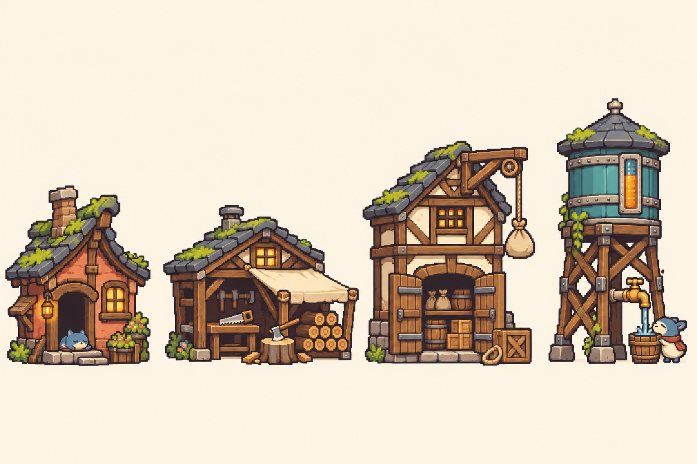

# Phase 3 · A colony that lives around the puzzle

A player selects a Sudoku cell while two friends toss a ball between a lodge and a storehouse. Rain reaches the top and bottom of the screen. A thirsty resident leaves the game, catches water from the hollow of a printed 9 and drinks. Later, while everyone has enough to drink, a resident measures a spot for a water tower. A request for the missing 7 still brings a helper to the number pad. The player can finish the puzzle without managing that afternoon's errands.

This is the specification for the next colony implementation. Phase 2 debug 0.2.0 is the gameplay baseline. The Library repair is independently testable in the 0.2.1 hotfix. The original three printed 4s and their amoeba remain the opening. The new five-decision creator starts with the first designed hatch after 5×5. Ordinary Sudoku remains available from first launch. [Phase 2 baseline](phase-2-debug-handoff.md) · [Library repair and remaining coverage](phase-3-library.md)

## A resident has a destination

Use one scene for the visible **Colony** play screen. The Sudoku grid, number supply, scrolling, fog mask and controls keep their existing input and state ownership. The scene owns a single visible body per resident ID. The resident who leaves a house is the same one who catches the ball, picks up a letter, drinks or delivers a digit. The job list can show their portrait. The former habitat card becomes a management entry point. Its old roaming sprite, the separate tray offer and the board-edge roamer currently repeat or duplicate the resident. Replace these visual projections when the new scene takes over. [Current habitat animation](../lib/settlement_scene.dart) · [Board and tray composition](../lib/colony_screen.dart) · [Current social projection](../lib/creature_social_view.dart)

Each occupied building has a door anchor. The square, dry spring, printed glyphs, selected tile, pad slots, construction sockets and torch stations have stable identities. Connect these with walkable paths around the protected play surface. A path has length, turn points, width and occupancy. Choose the next destination from unfinished jobs, nearby company, a favorite number, care and recent visits. Penalize the last two leisure destinations. A worker may legitimately retrace a delivery route. An idle resident pauses, turns, changes pace and can visit a different landmark. Friends can choose a shared route and split at their own doors.

A job supplies the worker ID, cargo ID, destination, start and due time. Movement uses distance traveled for footfalls, limb contact, turning, running, cargo grip and arrival. Replan from the current position on interruption. Save semantic endpoints, leg and progress. Recompute viewport coordinates after scrolling, layout changes and resume. Where a destination is offscreen, let the resident leave and return at the connected edge. Hidden residents continue eligible game work. Cap the animated cast at six, admit a visible job owner before an idle walker, and expose all residents through the focusable roster. A ball or a companion in flight never captures a puzzle tap.

**Phone layout.** Scatter homes, the lodge, public buildings and the square into free space beside the objective, at board corners, alongside the supply and below tools. Use a seeded choice of compatible footprints and connecting paths. On a narrow phone the world can continue down the scrollable page. On a tablet it can extend around both sides. The Sudoku digit faces, clue lines, focused control, current drag path, text, system insets and open sheets reserve space. If a site cannot fit, use another valid site or place it further down the scene. A resident can visit the edge of a verified favorite cell without obscuring its digit. A resident in a regular Library puzzle is an optional torch visitor under the setter's existing reveal mask.

**Building art.** Commission or license hand-drawn pixel sprite sheets for the center, lodge, houses, storehouse, workshop, hall and tower. Use two or more authored silhouettes for common homes and meaningful variants for the public buildings. Give the lodge a cutting block and stacked timber, the storehouse a loading door and visible inventory, houses a sleeping window, and the tower a raised tank with a gauge and working tap. Author foundation, framing and finished states, plus pixel attachment points for installed beams and roofs. An asset manifest declares source/license, palette, native scale, door, ground footprint, cover and socket anchors. Use integer scaling and the existing Hum palette. Seed plot selection, variant, roof, accessories and paths once per colony. Save the plan and remap its anchors on resize. The same seed restores its town, different seeds visibly change the town plan as well as paint. Gray harvested text remains readable while loads become timber and fittings. [Established visual system](../design.md) · [Existing construction and materials](../lib/campaign_construction.dart)

*Art direction reference generated for this specification.* The production sprite atlas should simplify each silhouette at its native pixel size and separate residents, moving props and weather into independent layers.

## Temperament makes meetings recognizable

Keep five hidden whole numbers per individual, each from 0 to 100: sociability, curiosity, tidiness, patience and boldness. New creatures roll them from a dedicated birth seed independent of chosen body, coloration and favorite digit. Persist the values. A curious resident pokes a letter and leans in, a tidy resident returns it to its stack, a patient one waits or shares a turn, a bold one throws a high ball, and a shy one can prefer a quiet walk. Display observations in their profile, such as “Waits outside Fern’s door.” The numeric scale stays out of controls, speech and accessibility labels.

For the first tuning pass, roll all five axes freely for 60% of births. For the other 40% sample one of four temperament centers and add independent jitter of ±12 per axis, clamped to range. In trait order above, start with (12,18,88,84,12), (88,82,12,16,88), (18,85,18,82,14) and (82,15,82,18,86). These are generation parameters, never named species. In a deterministic sample of 256 six-resident villages, target at least one strongly incompatible pair in 10–50% of villages and at least one close pair in 30–90%. Report observed rates, then tune without changing existing births.

For new pairs, let **D** be the mean absolute difference across the five traits. Set base affinity to `round(100 − 2.5 × D)`, clamped to −100…100. Store a separate memory adjustment from −15 to +15. Their combined score is clamped to the same range. Start at friendship at +35, close attachment at +65, dislike at −15 and hatred at −65. Values between dislike and friendship are acquaintances. Use a five-point margin to leave a band. Two residents 10 points apart on each trait start at +75. At D=50 they start at −25. At D=90 they start at −100 and remain hostile even after positive memories. Shared favorites and task preferences affect *where* a pair meets. Existing bonds migrate to their previous relationship band and retain their counts and named memories. Use a persisted legacy offset for existing pairs so reload never reclassifies a valued companion. Remove the Phase 2 initialization bonus for dissimilar tidiness on new pairs. [Current bond initialization](../lib/creature_ecology.dart) · [Current encounter selection](../lib/campaign_social.dart)

An invitation needs two free residents at reachable nearby anchors. Weight it by mood, compatibility, distance, recent partners and completed activities. Give each participant an activity slot. Sleepers, held offers, cargo trips and earned torch duties keep their reservations. A fresh encounter can start at most once per eight visible seconds per resident. A pair that just argued gets at least 60 visible seconds apart. Two groups can meet independently when there is room. Care and required jobs can interrupt a session. Settle relationship memory once when the event completes. An interrupted greeting cannot be farmed for affinity. **Work apart** ends the current social session, avoids future pairing until cleared and preserves the bond. Hostile residents still contribute to their colony.

| Activity | What the player sees and what happens afterward |
| --- | --- |
| Play together | An invitation, a short chase around two or three landmarks, a pause to swap leader, then a natural separation. A playful shy resident can watch first. |
| Walk together | Partners leave different doors, meet, match the slower gait, pause by a favorite digit and part at a fork. |
| Hug | Friends both approach, rotate to align their bodies, make brief contact and release. A resident can turn down an invitation. A gel leans into its partner, a many-legged creature folds its front limbs. |
| Toss a ball | One identifiable prop moves from a hand or body socket through an arc to a catch. A miss lands on a walkable patch and triggers retrieval. A worker called away drops or hands off the same ball. It stays scenery and never becomes a Sudoku digit or a material. |
| Argue or avoid | A disorderly pile or a blocked path can start an exchange of gestures, followed by withdrawal. Rivals prefer separate lanes. Strongly incompatible residents can glare, turn away or have the existing opt-in comic tussle. They cannot damage residents, buildings, puzzle state or food stocks. |

Keep **Reduced motion** and quiet antics independent of simulation. Show settled poses, a single prop owner and short summaries in the roster. Use ambient behavior outdoors during campaign play. Companion outings never transport village weather or use Android's overlay permission for the settlement.

## Rain, drinking and survival

Rain covers the visible Colony screen. Behind controls it reads as weather on the page, across the board as a faint wash under opaque digits and clues. Foreground drops pause around focused cells, drag targets and rule text. Reduced motion uses a still rain texture and a changing water level. Preserve the existing 45 visible seconds per weather cycle and 11-second shower. Water collects in actual closed contours of visible glyphs in the bundled font, including the separate bowls of an 8. A font's open 4 has no pool. Sources use unique IDs, so scrolling a wet letter away and back cannot refill it. A thirsty resident goes to the source, bends to scoop one cup, raises it to drink and leaves. Extra cups can be carried to storage. [Weather ledger](../lib/campaign_weather.dart) · [Rendered glyph contours](../lib/glyph_rain.dart)

Start the three needs when the village opens after clearing 6×6. The amoeba and every resident then have hydration, satiety and energy at 100. Later arrivals start at full meters. High means well supplied. Ordinary Sudoku, external companion visits, background time and **Play with Colony** pause the survival clock. Required work and existing offline production retain their established rules. Meters use visible simulation time with saved fractional remainders, independent of frame rate.

| Need | Initial balance target | How the resident recovers |
| --- | --- | --- |
| Thirst | Hydration loses 1 per 4 seconds and seeks water at 40 | Reserve one cup from a wet glyph, cistern or tower and drink on arrival for +60. A stocked tap trip takes 2 worker-seconds. A dry spring is always available for a 6-second trip. |
| Hunger | Satiety loses 1 per 6 seconds and seeks food at 40 | A 2-second pantry visit spends one ration for +60. A 6-second forage feeds the resident and banks one extra ration if space permits. Start with four rations, capacity eight. A planter watering yields two rations when water can be spared above four reserved for drinking. |
| Sleep | Energy falls 1 per 12 active seconds awake, plus 10 per completed visible work trip. A bundled load counts once. Rest at or below 25 | Walk home and sleep for four seconds to regain 80. A free quiet nest serves a resident who has no available house. Show a closed door or occupied nest until waking. |

These numbers are starting values for a debug playtest. Exhaustion suspends discretionary work until care succeeds. A hungry, thirsty or tired resident remains in the colony. Provide a **Care now** action and autonomous recovery. Finish required shatter, earned lights and requested digits on schedule. A required task may interrupt care before consumption. Persist the cup, ration or physical tile reservation and return it exactly once. Order remaining work by most overdue need, then pending player work, ordinary work and leisure. A zero-meter resident has first claim on the next optional shift. At zero, reserve the first gap after the current required leg for recovery. An already-promised torch or digit keeps its ETA. If required queues stay continuously full for 12 more active seconds, give the worker a packed drink or ration or a brief rest at the next handoff before accepting more discretionary work. The dry spring, forage and quiet nest keep basic recovery feasible with one body. In **One Helper** other residents may eat, drink, sleep and socialize. They consume their own portions, forage for themselves at empty stock, and occupy no economic job or communal production slot. The original amoeba can perform all required work and build the tower alone. Basic water, forage and sleep have no DNA or RNA cost.

**Why build a water tower?** After the village witnesses its first completed drink, a fed, rested resident with hydration above 40 and a free shift can survey a seed-selected site for three visible seconds. It carries a measuring stick, leaves pegs and proposes “Build a water tower here.” Record one plan per run, moving from eligible through survey, proposed, accepted, construction and complete. A deferred proposal stays in Projects without another survey. The player can accept, defer or pause. At the village stage the settlement notice must be able to supply every required material even if its original letters are exhausted. A thirsty resident drinks before proposing construction. Spend two support loads, a ring and a beam on the usual cutting, hauling and installation jobs. The last socket expands the existing reservoir from eight to twelve cups, preserving the old stock. A completed tower catches up to four cups at the start of each subsequent shower. Record the last credited shower ID with the deposit. Finishing during a shower earns its first water at the next shower start. A resident drinks at the tap even on dry ground. Four thirsty residents use eight worker-seconds at a stocked tap versus 24 at the spring. At 16 residents, steady-state demand is approximately three cups per 45 seconds. A dry spring still serves a crowd arriving together. The tower is optional at every ending.

The ecology, work and weather systems share worker availability, inventory ownership and a visible clock. Care cannot double-book a torchbearer. Requests cannot duplicate an intercepted cup. Key a rain pool by run, board or notice instance, source glyph, enclosed contour and shower. Eligible surfaces are displayed scenery, harvestable printed text and visible fixed givens. Pencil marks, player input, hidden clues and subpixel bowls do not collect water. If a source disappears before pickup, cancel its reservation and replan to a real source. After pickup the cup belongs to its named carrier through a board change or interruption. A carrier sends it to storage if unable to finish the drink. Saved water in a cup cannot be redrawn from the source. Capacity counts reserved and free water together. Sleep consumes neither a ration nor work energy. Thirst, leisure, surveys and rain give no solve reward. On prestige, preserve the retained resident's identity, personality and named memories. The new settlement starts with fresh infrastructure and full needs when it reaches village stage. Archive the previous tower and its residents' stories. [Settlement economy and prestige](phase-2-midgame-and-prestige.md)

## Five decisions, one reveal

Offer *one question at a time*. Step 1 shows six origins. Choosing one replaces that page with its immediate children. Back returns one question, with the previous answer selected. Show only the current answers, step number, available resources and what a choice does. No future tree, generated image, silhouette, name, favorite, personality, secret label, animation, alt text or accessibility node may reveal the individual before the hatch succeeds. The setup honors the player's preference to discover the creature from its conduct. The scripted first amoeba remains available for three printed 4s. [Phase 2 ecology IDs and work effects](../lib/creature_ecology.dart) · [Existing creator](../lib/creature_view.dart)

| Step | What appears | What is stored |
| --- | --- | --- |
| 1 · Origin | Six scenes: roots under floorboards, a warm den, a nest of husks, a sun-warmed ledge, damp mycelium by a lamp, and two pools running together. | Plant, mammalian, arthropod, reptilian, fungal or gel founder. |
| 2 · Habitat and first errand | Under that origin only, choose how to recover a loose digit in one of its two habitats. For example, catching a pair by bracing under the floorboard and catching a pair by following cracks are different children. Present two terrain group headings on this screen. They require no extra tap. | One valid habitat ID and one digit-response ID. Four choices per founder at 5×5, expanding to eight after 6×6. |
| 3–5 · Consequences | Three successive situations visit roof, light and coordination once each. The order, wording and objects follow the chosen habitat and earlier answers. Offer four contextual actions at each step. Each describes the practical result and when it can be learned. | One choice or training intention for each of the three families. A milestone or the learned-skill cap can defer its work benefit. Record that intention with the creature. |

For the twelve habitats, use the following order (roof R, light L, coordination C). Plant brace RLC, plant runner CRL, mammal trails LCR, mammal shelter RCL, arthropod heap CRL, arthropod silk CLR, reptile ledge LRC, reptile worksite RCL, fungus lantern LRC, fungus network CLR, gel current LCR, gel divide CLR. An earlier action supplies the next prop, location or problem. A support fitted on a roof makes that support the next lamp perch. Each reachable parent must have a child list in content data, with stable decision IDs, prompt, consequence text and authored effect mapping. A generic screen with only the step number changed fails this requirement.

For example, **roots under the floor → scoop up both digits beneath the brace → fit the first roof support → mark an entrance with light → pass a beam to a neighbor** produces a carrier with the existing Gather benefit at its first hatch. At 5×5 its quote remains 4 DNA and 8 RNA for the first designed resident. Three later choices are training intentions. When eligible, the player may train one for the existing 1 DNA and 2 RNA, once. A second example, **ground warmed by a lamp → race after a digit near that lamp → scout a dark entrance → read a posted beam mark → take the beam at a crossing**, takes the light branch first and can combine all four work responses by Arrows. The preview shows action text and price only. The player first sees the gait, coloring, face and personality of the resulting individual at birth.

Keep progression affordable: a player can choose an intention on any later step, including “leave this lesson open” where appropriate. No intention causes an automatic future debit. Keep the existing hatch quote for learned responses and beds, plus the existing milestone cap. “Leave this lesson open” is a separate defer control outside the four work responses. If more selected skills are eligible than the current cap allows, the player chooses which to learn now on the quoted fifth screen. A valid earlier selection is preselected; an accepted training intention later takes a slot and its quoted price only on one explicit confirmation. For a fully specified adult there are **6 origins × 2 habitats × 4 digit responses × 4 roof responses × 4 light responses × 4 coordination responses = 3,072 mechanically distinct combinations**. This count excludes random color, personality, favorites, click order and secrets. Preserve seeded individual variation, unusual rigs, variable limbs, and the four existing discoveries earned through witnessed acts after birth.

The fifth page has a single **Hatch · [price]** confirmation, a plain-language list of learned versus intended actions, and Back. Save the draft and command ID after each answer. A fifth answer opens the priced confirmation on that same page. An answered but uncommitted draft reopens at confirmation. Changing an answer invalidates its descendants and retains the compatible prefix. Reopening a draft resumes at the first unanswered step. On commit, validate the path, bed, milestone and current wallet. Persist debit, resolved identity and receipt in one transaction before publishing the new roster or reveal. A crash before commit restores the draft at no charge. A crash after commit replays the receipt and reveals the same individual. Phase 2 residents keep their IDs, rigs, phenotype, memories and paid skills. Map old drafts with recognized IDs to their longest valid prefix, retain any paid state and explain which question resumes. For example, an old plant-brace + Gather draft resumes after step 2. Preserve an old Fit Supports answer at its matching roof question even when another branch moved the roof question later in the sequence. A retained companion never has to hatch again.

## Delivery and debug acceptance

The Library repair can ship independently. The colony slices below are planned. Begin each with the indicated fixture and the oldest affected save. End each with a playable build, regression results and a short recording or accessible equivalent. The coordinator owns the shared contracts for world coordinates, worker occupancy, inventory, identity and time.

| Slice | Lead and dependency | What makes the slice pass |
| --- | --- | --- |
| S1 · World and art | Builder + UI/UX, first | On a portrait phone follow one resident through three non-collinear landmarks including a stop, a turn and an arrival, across the former habitat boundary. Show homes in at least two separated screen zones, a shop working and a named resident entering a door. Restore a seed-identical layout, then compare two other town silhouettes. Test 320, 375, 414 and 768 dp, 200% text, both themes, resizing and drag pass-through. |
| S2 · Personality and meetings | Mechanics + story, after S1 | Inject near-identical, dissimilar and opposite traits. Verify expected qualitative starting relations and distinct gestures. Show each of the five social activities, including a refused invitation and an interrupted ball toss. A replayed event gives no second credit. Work apart, reduced motion, saved relations and cargo ownership all survive reload. |
| S3 · Care, rain and tower | Incremental + builder, after S1 | During uninterrupted Sudoku play, record rain in all four viewport quadrants, a resident visiting an actual water source, a meal, sleep and a resident proposing a tower while hydrated. Test a dry, cashless, single-helper village, a full cistern, a second worker on a beam, a paused project, a mid-sip reload and eight hours away. Compare four drinks before/after the final socket and sixteen simultaneous drink requests with a nearly empty tank. No additional fog cell becomes visible. |
| S4 · Concealed hatch | UI/UX + mechanics, parallel with S1 | Complete two paths with different questions at step 3, edit a step, resume a draft, hatch once and record the reveal. Screen-reader labels, logs exposed to the player, hidden previews and focus order reveal no future branch or individual. Enumerate the 3,072 fully learned paths via legal player commands. Verify old limits and two equal recipes with distinct seeded personalities. |
| S5 · Integration and handoff | Coordinator after S1–S4 | Replay 4×4 → first designed hatch → village → water tower → staffed fog → retained companion prestige. With six visible residents, interrupt a social game with a digit request during rain, drag accurately and resume after relaunch. Profile the debug journey and benchmark animation in profile mode on a named midrange Android device; target ≤16.7 ms for p95 UI and raster frames at 60 Hz. Include a TalkBack and reduced-motion run, the native Library hotfix regressions, source commit, APK checksum and save-migration evidence. |

For each slice, the story reviewer checks that the reason for an action is visible; mechanics checks worker time, resource ownership and progression; UI/UX checks focus, touch and readability. A game builder demonstrates the normal entry point. The coordinator sends any mismatch back with its saved fixture and observable expectation. A physical playtest should ask what the last two residents were doing, why the tower was proposed, and whether the hatch was a surprise. Numeric balance and frame targets above remain playtest targets.
